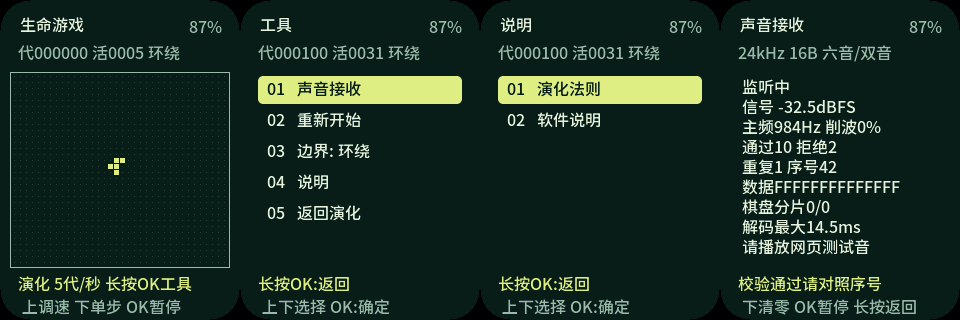

**简体中文** · [English](README.md)

# Life Passport 生命游戏

基于FoloToy AI Passport的康威生命游戏：独立中文界面、36×32棋盘、三键操作，
默认每200ms演化一代。保留完整[上游AI Passport项目](https://gitee.com/FoloToy/ai-passport)
及其BSP，应用开发位于`feature/game-of-life`分支。



图片来自真实应用的原生LVGL渲染，不是设备摄像照片。

## 行为

| 范围 | 行为 |
| --- | --- |
| 演化 | B3/S23、同步更新，可见棋盘边框，可选环绕或有限边界。 |
| 开机 | 从5个细胞的R五连块开始，以每秒5代自动演化。 |
| 图案 | R五连块、滑翔机、脉冲星、闪烁器、轻型飞船、28%密度随机宇宙、空白。 |
| 编辑 | 使用实体三键切换细胞生死，支持暂停、单步和重新播种。 |
| 电源 | 运行时保持正常亮度；手动或自动暂停后，30秒调暗、90秒熄屏、5分钟深睡。 |
| 存储 | 深睡通过RTC内存保留暂停棋盘；硬件断电后重新开始开机图案。 |
| 外部种子 | BLE完整校验并由实体键确认；手机交付方式正在调研，不要求安装Android应用。 |

## 操作

| 页面 | 上键／下键 | 确定键 | 长按确定 |
| --- | --- | --- | --- |
| 演化 | 上键调速；下键暂停并单步 | 播放／暂停 | 工具 |
| 工具／图鉴 | 移动选择 | 应用 | 返回 |
| 编辑 | 移动列；长按上下换行 | 切换细胞 | 返回并暂停 |
| 接收种子 | 不改变演化 | 应用；再按一次播放 | 取消并恢复 |

## 构建与验证

目标：ESP32-C3、8MiB Flash、无PSRAM、240×320屏幕、ESP-IDF **5.5.3**。
先阅读[AGENTS.md](AGENTS.md)和[环境指南](docs/development/engineering/environment-setup.md)。

```sh
./tools/validate.sh --static
./tools/validate.sh
```

完整门禁在`build/firmware/<sha256>/`保留合并镜像、匹配ELF/MAP及manifest。
合并镜像从**0x0**刷写，可能重置NVS/PHY数据，烧录前需获得目标设备授权。
禁止将应用单体镜像写到0x0。

| 检查 | 最近应用结果 |
| --- | --- |
| Build | PASS：完整ESP-IDF门禁及合并镜像验证。 |
| Host tests | PASS：规则、时钟、电源状态、协议、CRC、原生LVGL／字体／布局验证。 |
| Device tests | 已授权烧录、启动及75秒观察通过：30秒150代、60秒300代、正常亮屏状态、堆稳定、无看门狗复位。 |
| Unverified | 完整实体按键组合、颜色／字体肉眼检查、休眠唤醒恢复、电池及实测功耗；声音种子传输尚未实现。 |

已测试合并镜像为`8fc2e34c775f65c40a67b969eda3a416958a2ac3035e3c376ff2d5c4eef28b80`。
固件、原始私有日志和本地环境缓存不进入Git。

参见[应用说明](docs/game-of-life.md)、[外部种子状态及BLE协议](docs/mobile-control.md)
、[压缩与声音抗噪调研](docs/seed-transport-research.zh_CN.md)和[上游文档索引](docs/README.md)。
保留的`mobile/`目录属于探索原型，不是已经选定的种子共享方式。

## 许可

项目代码遵循上游[MIT许可](LICENSE)；Noto Sans SC字体子集保留
[OFL-1.1许可](assets/fonts/OFL.txt)和版权声明。
