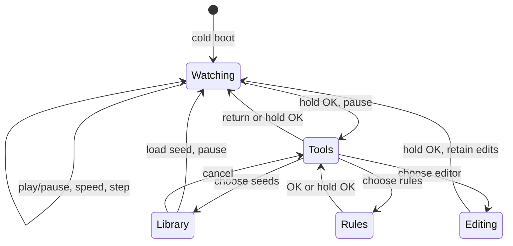

[简体中文](game-of-life.zh_CN.md) · **English**

# Game of Life

An offline Conway B3/S23 cellular-automaton playground for AI Passport. The application boots directly into a new interface: a dark green cell field, lime newborn cells, teal survivors, generation/population counters, battery indication, and context-sensitive key hints. It does not use the baseline hardware-test menu or its visual shell.

## Product behavior and acceptance

| Decision | Behavior and acceptance |
| --- | --- |
| Audience and goal | Explore emergent patterns on the three-key wearable, without a phone or network. |
| World | 36 columns × 32 rows with a visible border; synchronous eight-neighbor B3/S23 evolution. Wraparound joins opposite edges by default; finite edges treat outside cells as dead. |
| Timing | 1, 2, 5, or 8 generations per second. A late frame advances once; no catch-up burst may block input. |
| Initial state | Centered five-cell R-pentomino, running at 5 generations per second (200ms); the 36×32-board test verifies growth to at least 50 cells within 100 generations. |
| Seeds | R-pentomino, glider, pulsar, blinker, lightweight spaceship, random 28% density, and an empty canvas. Selecting a seed resets generation and pauses for inspection. |
| Completion states | Extinction or an unchanged live-cell arrangement pauses automatically; oscillators keep running. An empty world cannot start until seeded or edited. |
| Editing | One highlighted cell; toggle life with OK. Editing resets generation and leaves the simulation paused. |
| Storage | The application does not save the board or settings to Flash. Hardware power-off starts a new R-pentomino. Idle deep sleep retains the complete paused state in RTC memory. |
| Battery | Percentage in the top-right; unavailable readings show `--%`. |
| Power | Running stays at normal 65% brightness. The idle timer starts when manually or automatically paused: dim to 12% after 30 seconds, blank at 90 seconds, deep-sleep at 5 minutes. A connected sender's pending confirmation stays lit. The first key on a blank screen only wakes it. |
| Boundaries | Simulation works offline; optional BLE receives phone seeds with physical confirmation. No Wi-Fi, onboard speech recognition, audio playback, new wiring, or external board text. Existing BSP and partition layout are reused. |

## Controls

| Page | UP | DOWN | OK | Hold UP / DOWN | Hold OK |
| --- | --- | --- | --- | --- | --- |
| Watching | Cycle speed | Pause and advance once | Play / pause | No action | Open tools and pause |
| Tools / library | Previous item, clamped | Next item, clamped | Apply selection | No action | Return without applying the highlighted seed |
| Editor | Previous column, wraps | Next column, wraps | Toggle cell | Previous / next row, wraps | Return paused |
| Rules | No action | No action | Return to tools | No action | Return to tools |

Short actions occur on release. Long actions consume their subsequent release; rapid taps remain individual actions rather than being lost to the BSP double-click window. The tools page also offers reseeding, boundary switching, and return.

## Implementation and verification

| Layer | Source and contract |
| --- | --- |
| Model/controller | `main/life.c`, `main/life.h`; pure C, no ESP-IDF/LVGL dependencies. Model ownership stays in one application task. |
| Input | `main/life_keys.h`; callback queues bounded events, task reduces press/release/long sequences. Queue overflow fails explicitly. |
| UI | `main/life_ui.c`; one resident screen and a 4bpp indexed 216×192 canvas, about 20.3 KiB, avoiding one LVGL object/draw task per cell. All UI calls hold the BSP lock. |
| Board lifecycle | `main/main.c`; reuses BSP display/buttons/shared I2C/battery/codec suspend. Deep sleep releases the ADC keypad, arms GPIO wake, then suspends battery, audio, I2S, I2C, and display. |
| Fonts | `assets/fonts/life_font_16.c`, 16px, 4bpp, uncompressed Noto Sans SC subset under OFL-1.1. One explicit font is used by all text widgets. |

Each board render overwrites every indexed pixel directly and invalidates the canvas once. The native gate instruments the actual LVGL canvas functions and limits invalidating per-pixel calls, which are too costly on the ESP32-C3. Device telemetry reports generation and maximum UI-update duration alongside heap and task-stack margins every 30 seconds.

Recreate the font with Node 22.22.3 selected through fnm, `npm ci --prefix tools/font`, and `pip install -r tools/font/requirements.txt` in a Python virtual environment, then `python3 tools/generate_life_font.py --source <NotoSansSC-VF.ttf>`. FontTools 4.60.1 instances the source at weight 500. Source URL, license, hashes and code-point inventory are recorded in [assets](../assets/README.md) and `assets/fonts/life_font_inventory.json`. The static gate rejects an inventory gap or modified font bytes; startup and the native LVGL test validate every inventory glyph using `lv_font_get_glyph_dsc`, with a known-absent negative case.

Run `./tools/validate.sh` in ESP-IDF 5.5.3 for the shared static/firmware gate. The firmware gate verifies merged offsets, partition bounds, component bytes and matching ELF identity, and retains a content-addressed debug bundle. Flash the verified merged image at `0x0`; it can reset existing NVS/PHY data and replaces the installed application. Full-chip erase is not a prerequisite.

## Device acceptance still required

| Area | Physical checks |
| --- | --- |
| Startup | Correct orientation/colors, no assertion/reboot/watchdog, sufficient heap/largest block/task stack. |
| Input | All short/long keys, two rapid taps, long-release suppression, boundary/grid navigation, no missed events during 8 generations/second. |
| Display | Every page, selected row, empty/stable/extinct states, Chinese glyph shapes, punctuation, hints and round-corner clipping. |
| Power | Running remains bright; manual/automatic pause starts a fresh idle timer: dim at 30 seconds, blank at 90 seconds, deep sleep at 5 minutes. Check retention and wake-key guard. Measure current separately. |
| Battery | Plausible SOC and unavailable indication; test unplugged operation. |

Compilation, native rendering and host logic tests do not establish these physical results. Flash only after approval for the exact artifact and target port.
