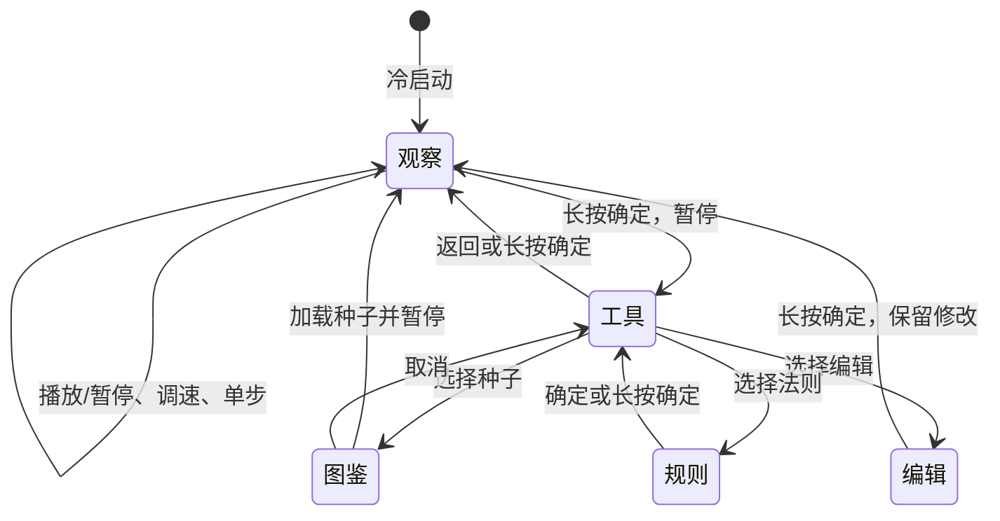

**简体中文** · [English](game-of-life.md)

# 生命游戏

面向 AI Passport 的离线康威 B3/S23 细胞自动机。开机直接进入独立界面：深绿色细胞场、浅绿新生细胞、青绿存活细胞、代数与存活数、电量和当前按键提示；不使用硬件测试菜单及其视觉外壳。

## 产品行为与验收

| 决策 | 行为及验收标准 |
| --- | --- |
| 使用者与目标 | 通过可穿戴设备的三个按键探索涌现图案，不依赖手机或网络。 |
| 世界 | 36列×32行，显示可见边框，八邻域同步执行 B3/S23；默认环绕边界、对边相连，可切换有限边界、将边缘之外视为空。 |
| 时间 | 每秒1、2、5或8代；晚到的帧只前进一步，不集中补算阻塞输入。 |
| 初始状态 | 居中5个细胞的R五连块，以每秒5代、200ms间隔自动演化；36×32棋盘测试验证其前100代会扩散到至少50个细胞。 |
| 种子 | R五连块、滑翔机、脉冲星、闪烁器、轻型飞船、28%密度随机宇宙、空白画布；加载后代数归零并暂停。 |
| 结束状态 | 全部消亡或细胞分布不再改变时自动暂停；振荡器继续演化。空世界需要重新播种或编辑后才能播放。 |
| 编辑 | 高亮当前细胞，确定键切换生死；编辑后代数归零，退出后仍暂停。 |
| 存储 | 应用不向Flash保存棋盘和设置；硬件断电后从R五连块重新开始。空闲深睡通过 RTC 内存保留完整暂停状态。 |
| 电量 | 右上角显示百分比；读数不可用显示 `--%`。 |
| 功耗 | 演化中保持65%正常亮度。手动或自动暂停时重新开始空闲计时：30秒调暗至12%、90秒熄屏、5分钟深睡；发送器保持连接时待确认画面持续亮屏。熄屏后的第一次按键只唤醒。 |
| 边界 | 基础演化离线，通过可选 BLE 接收手机种子并由实体按键确认；不增加 Wi-Fi、设备端语音识别、音频播放、新接线或外部设备文本，复用 BSP 和现有分区。 |

## 操作

| 页面 | 上键 | 下键 | 确定键 | 长按上键／下键 | 长按确定 |
| --- | --- | --- | --- | --- | --- |
| 观察 | 循环调速 | 暂停并前进一步 | 播放／暂停 | 无操作 | 打开工具并暂停 |
| 工具／图鉴 | 上一项，到顶停止 | 下一项，到底停止 | 应用选择 | 无操作 | 返回，不加载高亮种子 |
| 编辑 | 前一列，循环 | 后一列，循环 | 切换细胞生死 | 前一行／后一行，循环 | 返回并暂停 |
| 规则 | 无操作 | 无操作 | 返回工具 | 无操作 | 返回工具 |

短按在松手时生效，长按触发后松手不会重复执行短按；快速连按按独立操作处理，不被 BSP 的双击窗口吞掉。工具页还提供重新播种、边界切换和返回。

## 实现与验证

| 层级 | 源码与约束 |
| --- | --- |
| 模型／控制器 | `main/life.c`、`main/life.h`，不依赖 ESP-IDF/LVGL，由一个应用任务持有状态。 |
| 输入 | `main/life_keys.h`；回调只把有界事件入队，任务处理按下、松手、长按序列；队列溢出明确终止。 |
| 界面 | `main/life_ui.c`；单个常驻页面与约20.3 KiB的216×192四位索引画布，避免每个细胞分配 LVGL 对象和绘图任务。所有界面调用持有 BSP 锁。 |
| 硬件生命周期 | `main/main.c`；复用 BSP 的显示、按键、共享 I2C、电量计和 codec 挂起。深睡时释放 ADC 按键并设置 GPIO 唤醒，再按电量计、音频、I2S、I2C、显示顺序停止外设。 |
| 字体 | `assets/fonts/life_font_16.c`，16px、4bpp、无压缩的 Noto Sans SC 子集，OFL-1.1 许可；所有文本组件显式使用同一字体。 |

每次棋盘绘制直接覆盖全部索引像素，最后只使画布失效一次。原生验证通过实际 LVGL 画布函数的插桩限制逐像素失效调用，避免其在 ESP32-C3 上产生过高开销；设备每30秒输出代数、最大界面更新时间及堆和任务栈余量。

使用 fnm 选择 Node 22.22.3，执行 `npm ci --prefix tools/font`，在 Python 虚拟环境执行 `pip install -r tools/font/requirements.txt`，再执行 `python3 tools/generate_life_font.py --source <NotoSansSC-VF.ttf>` 重建字体。FontTools 4.60.1 在转换前实例化为字重500。[资产说明](../assets/README.zh_CN.md)和 `assets/fonts/life_font_inventory.json` 记录来源、许可、校验值及码点清单；静态验证拒绝清单缺字和字体内容变化，启动与原生 LVGL 测试通过 `lv_font_get_glyph_dsc` 检查每个码点，并包含确定缺失的反例。

在 ESP-IDF 5.5.3 环境执行 `./tools/validate.sh` 完成统一静态和固件验证。固件验证检查合并偏移、分区边界、组件字节与 ELF 身份，并保留按内容哈希归档的调试包；验证后的合并镜像从 `0x0` 刷写，会替换原应用并可能重置 NVS/PHY 数据，不需要例行整片擦除。

## 仍需真机验收

| 范围 | 实物检查 |
| --- | --- |
| 启动 | 方向和颜色正确，无断言、循环重启、看门狗；堆、最大连续内存、任务栈余量充足。 |
| 按键 | 全部短按／长按、快速连按、长按松手不重复、边界和编辑导航、每秒8代时不丢事件。 |
| 显示 | 全部页面、选中项、空白／稳定／消亡状态、汉字形状、标点、提示文字及圆角裁切。 |
| 功耗 | 演化中保持正常亮度；手动／自动暂停后重新计时，30秒调暗、90秒熄屏、5分钟深睡；检查状态保留和唤醒键屏蔽，电流另行测量。 |
| 电池 | SOC 合理、不可用标记正确，并测试拔线运行。 |

编译、原生界面渲染和主机逻辑测试不能证明以上实物结果。仅在确认具体固件与目标串口并得到授权后烧录。
