[简体中文](seed-transport-research.zh_CN.md) · **English**

# Fixed-board compression and acoustic reliability

Research date: 2026-10-27. The target is an exact 36×32 binary board sent from a
browser speaker to the AI Passport microphone, without installing a phone app.
These are reproducible host experiments and candidate extensions. The current
[LP1 laboratory](acoustic-lab.md) implements fixed 16-byte key/diagnostic reception;
arbitrary-bitmap compression and outer erasure coding below remain research.

## Findings that affect the design

| Question | Finding |
| --- | --- |
| Minimum data | Preserve provenance: a shared pattern ID or a versioned random-generation recipe can replace a whole bitmap. Arbitrary edited boards need a general lossless codec. |
| Fixed dimensions | Width and height are protocol constants and are not transmitted. The uncompressed board is exactly 1152 bits / 144 bytes. |
| General compression | Compare cropped bitmaps, sparse/combinatorial positions and entropy coding, including their metadata. Always retain the 144-byte bitmap as a bound. |
| Noise | Combine audio synchronization, inner error correction, CRC-validated short frames, erasure recovery and cyclic retransmission. CRC alone cannot repair data. |
| Memory | GGWave's variable-length receiver needs about 4MiB in the measured configuration. Use fixed short frames and receive-only mode. |
| User time | Minimize expected time to a verified board, including frame padding, redundancy and retries; minimum payload bytes alone are insufficient. |

## Compression of a fixed 1152-bit board

There are `2^1152` possible boards. A lossless representation cannot make every
possible board shorter than 1152 bits. Known density and spatial structure can
reduce the typical size; shared generation rules can reduce it much further.

The shared protocol fixes 36×32, B3/S23 and the cell traversal order. A seed
contains alive/dead bits; cell-age shading, counters and screen state stay local.
Boundary and playback-speed choices need only their small control fields.

| Representation | What is sent | Applicability and requirements |
| --- | --- | --- |
| Shared pattern | Pattern ID; placement, transform and generation only when needed | A centered predefined pattern can use one byte for its content ID. Pin the pattern-table version. |
| Random recipe | PRNG identifier/version, seed and density | Roughly 6–12 content bytes depending on field sizes. Both sides must implement exactly the same PRNG, bit ordering and zero-seed behavior. An edit invalidates this recipe. |
| Pattern plus generation | Initial pattern ID and bounded generation count | Reconstruct by simulation with identical board dimensions, rule and boundary. Cap the reconstruction time and verify the reconstructed board. |
| Cropped bitmap | Subrectangle location/extent and its packed cells | This prototype packs the crop header into 22 bits / 3 bytes. These fields describe a crop, not the already-known whole-board dimensions. |
| Sparse positions | Live or dead count plus 11-bit cell indices | Useful for sparse scattered cells; choose the less common cell value. |
| Enumerative coding | Count `k` and rank among `C(1152,k)` boards | Uses `ceil(log2(C(1152,k)))` rank bits, plus count/mode. Host prototype round-trips exactly; multiprecision arithmetic costs need target measurement. |
| Range / ANS | Fixed or transmitted probability model and coded binary cells | Can use left/top neighbors as context. Include probability tables, coder termination and word padding in the count. |
| DEFLATE | Raw DEFLATE stream | Standard-library reference; effective for some structured states, but not automatically best for a 144-byte object. |

Enumerative coding is a classical approach to indexing constrained binary sequences;
see Cover's [original paper](https://isl.stanford.edu/~cover/papers/transIT/0073cove.pdf).
The experiment uses a colexicographic combinatorial rank and Python's exact `math.comb`.
It does not claim to implement the paper's particular lexicographic bitstream.

### Bitmap and combinatorial benchmark

This baseline compares bitmap/crop, sparse indices, enumerative coding and DEFLATE;
the Range/ANS comparison follows separately. The sizes include **one codec/mode byte**, but exclude the shared object
header, CRC and FEC. Fixtures come from the actual `main/life.c`, not hand-copied
pattern definitions. Shared pattern IDs and generation recipes are separate proposals.

| Board | Live cells | Best tested representation | Bytes |
| --- | ---: | --- | ---: |
| Empty / full | 0 / 1152 | Constant mode | 1 |
| Blinker | 3 | Cropped bitmap | 5 |
| R-pentomino / glider | 5 | Cropped bitmap | 6 |
| Lightweight spaceship | 9 | Cropped bitmap | 7 |
| Pulsar | 48 | Cropped bitmap | 26 |
| R-pentomino, generation 50 | 64 | Enumerative | 48 |
| R-pentomino, generation 100 | 31 | Enumerative | 29 |
| R-pentomino, generation 300 | 26 | Enumerative | 25 |
| Firmware random seed 42, density 28% | 321 | Enumerative | 126 |

The corpus also includes 100 reproducible random boards at each of seven densities,
for 713 boards in total. Every candidate performs an exact decoding round trip.

| Random density | Best-size range | Median bytes |
| --- | ---: | ---: |
| 1% | 7–21 | 14 |
| 5% | 33–53 | 44 |
| 10% | 62–80 | 70 |
| 28% | 120–132 | 126 |
| 50% | 145–145 | 145 |
| 90% | 59–79 | 70 |
| 99% | 8–23 | 15 |

These are results for the implemented candidates, not a proof of global optimality.
For an independent Bernoulli(0.28) source, the entropy estimate is about 123.2 bytes
before model/termination overhead. Enumerative coding already approaches this regime;
the uniform 50% source has entropy 144 bytes. Byte-aligned modes/counts can be packed
more tightly if doing so actually saves an acoustic frame.

### Range and ANS benchmark

Using [constriction 0.4.2](https://github.com/bamler-lab/constriction/tree/v0.4.2),
all 713 boards also round-trip through six entropy configurations. These counts
include the library's 32-bit-word padding and termination, one mode byte, and
one fitted probability byte or four context-probability bytes where applicable.
Whole-board dimensions remain protocol constants.

| Board or cohort | Best baseline | Range, fitted density | Range, left/top contexts | ANS, left/top contexts |
| --- | ---: | ---: | ---: | ---: |
| R-pentomino | 6 | 10 | 9 | 13 |
| Pulsar | 26 | 42 | 33 | 33 |
| R-pentomino, generation 50 | 48 | 50 | 29 | 33 |
| R-pentomino, generation 100 | 29 | 30 | 21 | 25 |
| R-pentomino, generation 300 | 25 | 26 | 21 | 21 |
| Random 28%, median | 126 | 126 | 129 | 133 |
| Random 50%, median | 145 | 150 | 149 | 153 |

A shared fixed 28% model reaches a 125-byte median with Range Coding in the 28%
cohort, slightly below the enumerative result, without transmitting a fitted model.
For structured evolution states, spatial contexts give a larger improvement.
They do not help an independent random source, and all codecs still need the raw fallback.

The models quantize probabilities to one of 255 nonzero byte-representable values;
four contexts are selected by the already decoded left and upper cells, with zero
outside the first row/column. Encoder and decoder use identical fixed-point model
construction (`perfect=False`). The receiver need not store a transmitted context
map. Pin the exact integer CDF construction and codec version for browser/firmware
compatibility; target memory and decoding deadlines remain unmeasured.

## Reliability: the useful analogy with QR codes

DENSO documents QR's Reed–Solomon error correction and the trade-off between
redundancy and restoration. Its percentages refer to codewords; they are not a
guarantee that an arbitrary percentage of an image, or of an audio recording, can
be destroyed. [DENSO's explanation](https://www.qrcode.com/en/about/error_correction.html)

| Mechanism | Failure addressed | Cost / boundary |
| --- | --- | --- |
| Preamble and pilots | Starting playback mid-loop, clock/frequency offset | Add airtime; reacquire between short frames. |
| Audible FSK | Tone detection with background noise | Select bands using this microphone/speaker pair; ultrasonic reception is not validated. |
| Inner RS/ECC | A limited number of damaged symbols within a frame | More parity lowers net data rate. GGWave already provides inner ECC. |
| CRC per frame | Corrupted header, shard index or content | Reject the whole invalid frame so it can be treated as an erasure. |
| Interleaving | A contiguous noise burst hitting adjacent symbols | Spreads damage across codewords, at the cost of buffering and latency. |
| Outer erasure FEC | Lost or CRC-rejected complete frames | Recover from any sufficient set of valid shards. |
| Cyclic replay and deduplication | Missed start, intermittent noise | Retain good shards across loops; do not repeatedly replace the board. |
| Whole-object CRC and bounded decode | Residual corruption or incompatible reconstruction | Apply only after complete verification and local confirmation. CRC is not authentication. |

### Error and erasure experiments

The byte-error example protects a 156-byte object (8-byte example header, 144-byte
board, 4-byte CRC32) with 32 parity bytes. It is separate from the packet-erasure example.

| Damage model | Trials | Exact recoveries |
| --- | ---: | ---: |
| 16 unknown erroneous bytes | 100 | 100 |
| 32 known erasures | 100 | 100 |
| 8 errors plus 16 erasures | 100 | 100 |
| 17 errors, beyond the configured bound | 100 | 0; all rejected |
| 33 erasures, beyond the configured bound | 100 | 0; all rejected |

The relation is `2*errors + erasures <= parity_symbols`. Exceeding it provides no
recovery or detection guarantee, so whole-object verification remains necessary.
The package used for this experiment is [reedsolo 1.7.0](https://pypi.org/project/reedsolo/1.7.0/).

For burst damage, four independent 39-byte blocks each get 8 parity bytes. A
12-byte contiguous burst fails without interleaving and recovers after four-way
interleaving, with the same 32 total parity bytes. This comparison is between
those short-block layouts; it does not imply a single larger RS block fails the same burst.

For packet loss, pad the 156-byte example to ten 16-byte source shards and add four
repair shards using column-wise RS. All **1001** combinations of four lost shards
out of fourteen were tested and reconstructed the exact original. This is a host
erasure model, not a microphone measurement or a claimed RFC wire-format implementation.
The MDS erasure principle is described in [RFC 5510](https://www.rfc-editor.org/rfc/rfc5510.txt).

| Independent frame-loss model | Ten data frames, one pass | Ten data + four repair, one pass | Ten data, two full passes |
| --- | ---: | ---: | ---: |
| 10% per-frame loss | 34.9% | 99.1% | 90.4% |
| 20% per-frame loss | 10.7% | 87.0% | 66.5% |

The table is a binomial calculation. Real room noise can create correlated losses,
which is why interleaving, replay and acoustic measurement are still needed.

## GGWave resource and waveform measurements

Pinned dependency: [GGWave 060aec73](https://github.com/ggerganov/ggwave/tree/060aec73dd7123ccac200442f75bdc7369795ffe), MIT.
The measurements use its public `prepare(parameters, false)` / `heapSize()` API,
24kHz, 512-sample FFTs, I16 microphone input, receive-only mode, DSS, and one protocol.
Sizes are host buffer calculations; the host object adds 1464 bytes. They exclude
the application task stack, codec reactivation and integration overhead.

| Protocol / fixed payload | Calculated RX heap | Waveform duration |
| --- | ---: | ---: |
| Variable-length | 4,219,368 bytes | Not a candidate for current RAM |
| DT_FASTEST / 8 bytes | 31,032 bytes | 0.768s |
| DT_FASTEST / 16 bytes | 46,512 bytes | Not measured |
| DT_FASTEST / 24 bytes | 61,992 bytes | 2.048s |
| DT_FASTEST / 32 bytes | 80,608 bytes | Not measured; too close to the 80KiB largest free block |
| MT_FASTEST / 8 bytes | 49,464 bytes | 1.536s |
| MT_FASTEST / 16 bytes | 80,304 bytes | Not measured; limited integration margin |
| MT_FASTEST / 24 bytes | 111,144 bytes | 4.096s; exceeds the recorded 91KiB free heap |

The board's existing audio BSP provides PCM input. Its shipped default is 16kHz;
the proposed 24kHz format or resampling path still needs on-device clock and resource
validation. The 512/24000 block interval is 21.33ms, a real-time budget that a host
FFT benchmark cannot establish for an ESP32-C3 without hardware floating point.

### Simulated channel results

Each entry is ten independently generated frames. Noise also covers the leading
and trailing silence, and decoder input is quantized to signed 16-bit PCM. Conditions
are tested separately, not as a combined worst case. Exact decoded content is checked
and wrong CRC candidates are discarded. This is **640 software trials, no physical test**.

| Channel model | DT / 24B | MT / 24B | MT / 8B |
| --- | ---: | ---: | ---: |
| Clean | 10/10 | 10/10 | 10/10 |
| Gaussian noise, SNR -15dB | 0/10 | 9/10 | 6/10 |
| 500ms dropout within the frame | 0/10 | 9/10 | 0/10 |
| Playback sped up by 1% | 0/10 | 10/10 | 10/10 |

These small samples expose trade-offs rather than guaranteed success rates. In
particular, the longer MT frame costs more memory and airtime. Shortening it can
fit current RAM but consumes a larger fraction of each frame for headers/CRC.
Test frequency acquisition and sample-rate drift before selecting a DT profile.

## Proposed direction and acceptance gates

```mermaid
flowchart LR
    A[Fixed board or versioned recipe] --> B[Choose smallest supported representation]
    B --> C[Object metadata and CRC]
    C --> D[Adaptive erasure shards]
    D --> E[Frame header and CRC]
    E --> F[Inner FEC and audible waveform]
    F --> G[Microphone short-frame decoder]
    G --> H[Validate frame and collect shards]
    H --> I[Recover, decode and verify object]
    I --> J[Paused preview and physical confirmation]
```



Use shared pattern/recipe modes where they exactly describe the board, then choose
among generic codecs and the raw-bit fallback. Pin codec/model versions and cap
output at 1152 cells; unknown modes, impossible counts and overlong reconstruction
must fail before application. Keep verified shards across repeats with a transaction
ID and object checksum, including late join, changed seed, timeout and cancel states.

An illustrative 24-byte acoustic frame can hold a 6-byte header, 16 shard bytes
and a 2-byte frame CRC. A dense 156-byte object then needs ten source and four
repair frames: `14 * 2.048 = 28.672s`, before inter-frame gaps, acquisition and replay.
This layout and timing are a proposal, not a fixed protocol. Smaller objects should
use fewer frames and adaptive redundancy. A slower MT choice needs a separate layout.

| Remaining gate | Required evidence before claiming device support |
| --- | --- |
| Decoder resources | Peak heap, largest block, stack, initialization failure handling and per-block time on the actual C3; leave operating margin. |
| Browser playback | iPhone/Safari and Android/Chrome playback, actual sample rate, volume controls, looping gaps and speaker frequency response. |
| Acoustic channel | Repeated tests at agreed distances, angles and noise levels; include speech, music, clipping, bursts and drift. Record verified-transfer latency and failures. |
| Integrity and lifecycle | No board change for partial/invalid input; no mixed transactions; explicit cancel/timeout; microphone and tasks stop cleanly. |
| Interaction | Enter receive mode, show progress/error, pause on complete verified board, physical apply/cancel; no phone app installation. |

## Reproduce and inspect the evidence

The [data files](research-data/seed-sizes.json) are generated by the scripts under
[`tools/research`](../tools/research), not by manually filled success tables.
Python dependencies are pinned in [`requirements.txt`](../tools/research/requirements.txt).

```sh
python3 -m venv work/research-venv
export PYTHONPYCACHEPREFIX="$PWD/work/research-pycache"
work/research-venv/bin/python -m pip install -r tools/research/requirements.txt
work/research-venv/bin/python tools/research/seed_sizes.py
work/research-venv/bin/python tools/research/entropy_trials.py
work/research-venv/bin/python tools/research/fec_trials.py
git clone https://github.com/ggerganov/ggwave.git work/research-ggwave
git -C work/research-ggwave switch --detach 060aec73dd7123ccac200442f75bdc7369795ffe
cmake -S tools/research -B work/research-native -DGGWAVE_ROOT="$PWD/work/research-ggwave" -DCMAKE_BUILD_TYPE=Release
cmake --build work/research-native --parallel 4
work/research-native/ggwave_memory
work/research-venv/bin/python tools/research/acoustic_trials.py --library work/research-native/ggwave/src/libggwave.dylib
work/research-venv/bin/python tools/research/acoustic_trials.py --library work/research-native/ggwave/src/libggwave.dylib --payload 8 --output work/research/acoustic-trials-8.json
```

On Linux replace `.dylib` with `.so`; Windows uses its CMake-generated DLL location.
Recorded environment: macOS arm64, Python 3.9.6, zlib 1.2.12, reedsolo 1.7.0,
constriction 0.4.2 and NumPy 1.26.4.
All scratch downloads, native builds and audio buffers remain under ignored `work/`.

| Evidence | Scope |
| --- | --- |
| [Seed sizes](research-data/seed-sizes.json) | Actual firmware patterns, compression round trips, reproducible density cohorts. |
| [Range/ANS sizes](research-data/entropy-trials.json) | Six entropy configurations on the same 713 boards, with metadata and word padding included. |
| [FEC trials](research-data/fec-trials.json) | Byte-error bounds, burst interleaving, exhaustive four-shard erasures and loss calculations. |
| [RX buffers](research-data/ggwave-memory.csv) | Public GGWave buffer-size calculation. |
| [24-byte waveforms](research-data/acoustic-trials.json) | Two protocols across sixteen channel conditions, ten trials per cell. |
| [8-byte waveforms](research-data/acoustic-trials-8.json) | Same experiment with shorter payloads. |
